# Incident Timeline Builder

[](https://github.com/sonujha78/incident-timeline-builder/actions/workflows/ci.yml)


When a service breaks, the first twenty minutes usually go to one question: **what changed, and when?**
The answer is spread over Git, the container platform, application logs and health checks, and the
postmortem is later written from memory.

This tool collects events from four sources, puts them in **one clock-corrected timeline**, finds the
**incident window**, **ranks the changes that most likely caused it (with a reason for every point)**, and
writes a **postmortem draft in Markdown** with real numbers. When the data does not point to a clear cause,
it says so instead of guessing.

Everything runs locally and in CI, with no paid service. The analysis works from recorded data files, so the
same incident always gives the same report.

> Project 3 of my DevOps portfolio. Python (standard library + PyYAML), Docker Compose for the demo environment.

---

## Results at a glance

Four incidents were recorded from real containers, each with a known cause (ground truth). Two clocks are
skewed on purpose: the git/deploy clock runs **60 s ahead** and the app log writes **naive IST time**.

| Incident | Type | Start error | End error | Cause rank | Confidence | Checks | Result |
|---|---|---|---|---|---|---|---|
| bad_deploy | bad deploy | +1.0s | +0.1s | #1 | HIGH | 10/10 | PASS |
| failing_dependency | failing dependency | +1.0s | +0.5s | #1 | HIGH | 10/10 | PASS |
| resource_exhaustion | resource exhaustion | +0.5s | -0.1s | #1 | HIGH | 10/10 | PASS |
| no_clear_cause | no clear cause | +1.0s | -0.0s | none expected | LOW | 11/11 | PASS |

- Start and end are within **±5 s** of the truth (tolerance stored in each `ground_truth.json`, tested in CI).
- The injected 60 s git skew is recovered automatically (estimated -61.0 to -61.5 s; the extra ~1.5 s is the real
  delay between the deploy record and the container start, which is left visible on purpose).
- The no-cause incident gives a **LOW-confidence report that says "No clear trigger"**.
- Same data gives the same report, byte for byte (checked by tests and in CI, on Python 3.12 and 3.14).
- 127 automated tests. The CI job fails if any result differs from the known cause.

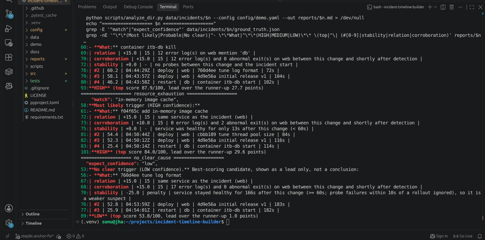

Example reports: [`docs/examples/bad_deploy_postmortem.md`](docs/examples/bad_deploy_postmortem.md),
[`docs/examples/no_cause_postmortem.md`](docs/examples/no_cause_postmortem.md) and one per recorded incident
in [`reports/`](reports/).

---

## Architecture

```mermaid
flowchart LR
  subgraph demo["Docker Compose demo (project itb)"]
    W["itb-web :18080"]
    DB["itb-db :18081"]
  end
  SC["demo/scenario.py<br/>runs an incident with a known cause<br/>and records it (redacts every line)"]
  demo --> SC
  SC --> DATA["data/incidents/NAME/<br/>git.jsonl, docker.jsonl, app.log, health.jsonl<br/>meta.json, ground_truth.json"]
  DATA --> COL["collectors<br/>one module per source"]
  COL --> EV["Event<br/>ts, source, type, service, description<br/>UTC, redacted, deterministic id"]
  EV --> CLK["clock correction<br/>anchor pairs, cluster voting"]
  CLK --> TL["merged timeline"]
  TL --> DET["incident window<br/>configurable thresholds"]
  DET --> RK["suspect ranking<br/>explainable score + confidence"]
  RK --> PM["postmortem.md<br/>TTD / TTR, next steps"]
  PM --> CHK["itb check<br/>compare with ground truth"]
  CHK --> CI["GitHub Actions<br/>fails on any mismatch"]
```

**Live vs replay.** The recorder only *writes* files; analysis always *reads* files. Live and replay therefore
go through exactly the same code, and an old incident can be analysed again later with the same result.

---

## Quick start

Needs Python 3.10+ (CI runs 3.12 and 3.14). Docker is only needed to record new incidents.

```bash
git clone https://github.com/sonujha78/incident-timeline-builder.git
cd incident-timeline-builder
python3 -m venv .venv && source .venv/bin/activate
pip install -e ".[dev]"

pytest -q                                   # 127 tests
itb check -v                                # all recorded incidents vs ground truth (exit code 1 on mismatch)
itb analyze data/incidents/bad_deploy --config config/demo.yaml            # postmortem draft (Markdown)
itb analyze data/incidents/bad_deploy --config config/demo.yaml --json     # short machine-readable summary
```

Record a new incident (about 3-5 minutes each, needs Docker + Docker Compose):

```bash
python demo/scenario.py up                   # build image, start itb-web + itb-db
python demo/scenario.py run bad_deploy       # or: failing_dependency | resource_exhaustion | no_clear_cause | all
python demo/scenario.py down                 # remove itb-* containers and the network
python demo/scenario.py clean                # down + remove the demo image and demo/run
```

The demo only touches things named `itb-*`, uses ports `18080` and `18081` bound to `127.0.0.1`, and never
touches other containers on the machine.

---

## How it works

### 1. One event format

Every source is turned into the same `Event`: `ts` (corrected UTC time), `source`, `type`, `service`,
`description`. It also keeps `raw_ts` (what the source said), `skew_applied_s` (the correction), `attrs` and a
deterministic `event_id` (hash of the content). A new source is one module with
`collect(path, tz) -> list[Event]` plus one line in the registry.

| Source | File | What becomes an event |
|---|---|---|
| git | `git.jsonl` | deploys and config changes |
| docker | `docker.jsonl` | `docker events` (start, kill, die, stop, oom) |
| applog | `app.log` | ERROR/WARN lines as `error_log`, INFO as `info` |
| health | `health.jsonl` | one probe per line, ok or failed, error rate |

### 2. Clock skew without hiding real delays

- Each source gets **one constant offset**, never a per-event stretch, so real delays stay visible.
- The offset is estimated from **anchor pairs**: a git `deploy` should be followed by a docker container `start`.
  Candidate offsets are grouped and the offset that explains **the most deploys** wins (cluster voting).
- The offset is applied only if there are at least 2 pairs, the pairs agree (spread ≤ 10 s) and the offset is
  larger than 1 s. Otherwise the tool does **not** correct and writes the reason in the report.
- `manual_skew_s` and per-source timezones can be set in the config and win over the estimate.
- `raw_ts` is always kept, and every corrected row shows its correction in the timeline.

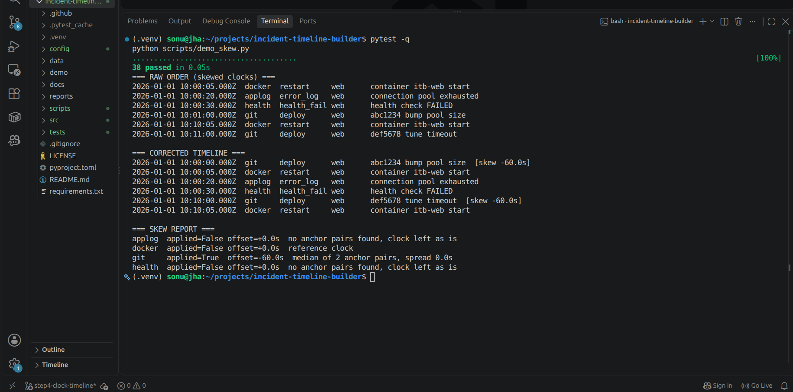

### 3. Incident window

From the health probes of each service, with configurable thresholds (`config/itb.yaml`):

- A probe is *bad* if the check failed or `error_rate >= 0.05` (latency threshold optional).
- An incident **opens after 3 bad probes in a row** and **closes after 3 good probes in a row**, so short blips
  are ignored and one good probe in the middle does not end it.
- Incidents closer than 30 s are merged (flapping); closed ones shorter than 10 s are dropped.
- If no recovery is seen, the incident is `ongoing` and has no end. The end is never guessed.
- Accuracy is **one probe interval**; it is stored with the incident and tested.

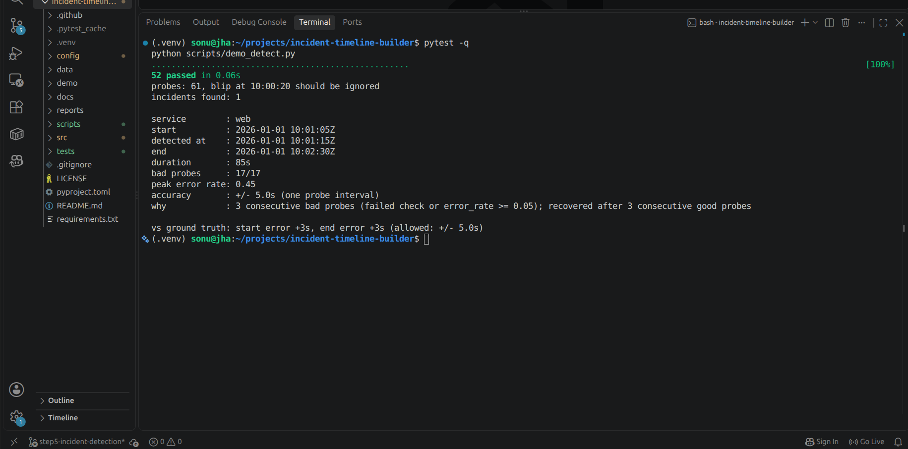

### 4. Suspect ranking (every point has a reason)

Changes (deploy, config, container events) in the 600 s before the incident are scored from 0 to 100:

| Component | Points | Meaning |
|---|---|---|
| proximity | up to 40 | closer to the incident start, more points |
| change_type | deploy 20, config 15, restart 8 | |
| relation | up to 15 | same service, or named in the error logs of the affected service |
| corroboration | up to 15 | error logs or abnormal exits appeared after the change |
| evidence | up to 10 | direct failure signal on the change (OOM, non-zero exit) |
| stability | -25 | the service stayed healthy for 60 s+ after the change, so it is a weaker suspect |

To make it hard to fool:

- **A symptom is not a cause.** The affected service's own `oom` or `die` is a symptom, not a suspect.
- **A rollout is not a cause.** The container stop/kill/die/start right after a deploy is that deploy's
  rollout, listed as "not treated as suspects" with the reason.
- **One failure counts once.** `kill` followed by `die` of the same container within 5 s is one failure.
- **Probe failures during a rollout are ignored** when checking whether the service was stable.
- **Changes after the incident start** (for example the rollback) are not suspects.

### 5. Confidence and honesty

Confidence is **HIGH** (score ≥ 70 and lead ≥ 15 over the runner-up), **MEDIUM** (≥ 50 and lead ≥ 8) or **LOW**.
It is lowered when the evidence is weak:

- No change in the lookback window: LOW, "the cause cannot be determined from this data".
- Two suspects too close to separate: LOW.
- A source clock could not be corrected: HIGH becomes MEDIUM.
- A container start appears **before** the deploy it should follow (clocks must disagree): forced to LOW.
- The top suspect is a long-stable change (service healthy for 60 s+ afterwards): capped at LOW.

Scores are heuristic points, not probabilities, and the report says so.

### 6. Postmortem draft

Summary, impact table (TTD, TTR, bad probes, error rate), timeline (probes collapsed, repeated lines collapsed,
row limit), most likely trigger with the full score breakdown, other candidates, events that were *not* treated
as suspects, confidence with reasons, clock correction table, rule-based "what to check next", and a section for
a human to fill in. There is no wall-clock time inside the report, so it is reproducible.

- **TTD** = first bad probe until the detection rule fired.
- **TTR** = first bad probe until the first good probe of the recovery.

### 7. Secrets

Removed in three places: when the recorder writes a line, when an `Event` is built, and on the final Markdown.
The demo app writes fake credentials into its logs and into a commit message **on purpose**; a test and a CI step
scan `data/`, `reports/` and `docs/` for them and fail if one appears.

---

## Requirements and acceptance criteria

| Requirement | Where |
|---|---|
| 1. At least 3 source kinds | git, docker, app log, health probes (`src/itb/collectors/`) |
| 2. Common event format | `src/itb/events.py` |
| 3. Disagreeing clocks | `src/itb/clock.py`, tests `test_clock*.py`; demo has +60 s git skew and an IST app log |
| 4. Incident window, configurable | `src/itb/detect.py`, `config/itb.yaml` |
| 5. Ranked, explainable suspects | `src/itb/rank.py` (component + reason per point) |
| 6. Time to detect / recover | `src/itb/metrics.py`, in the Impact table |
| 7. Markdown postmortem | `src/itb/postmortem.py` |
| 8. Secrets removed | `src/itb/redact.py`, `src/itb/record.py`, `tests/test_no_secrets_in_data.py`, CI scan |
| 9. Replay gives the same result | `src/itb/replay.py`, `data/incidents/`, byte-for-byte test and CI step |
| 10. Local and CI, no paid service | Docker Compose locally; CI replays recorded data only |

| Acceptance criterion | How it is checked |
|---|---|
| All sources in one correctly ordered timeline, with skewed clocks | `itb check`: "all sources in one timeline", "timeline is time-ordered", "injected git clock skew recovered" |
| Start and end close to the real ones, tolerance stated and tested | `start within tolerance`, `end within tolerance` (±5 s) |
| Real cause in the top 3, reason shown | `real cause ranked in top 3` (all three are #1) |
| TTD and TTR in the postmortem | `TTD and TTR are in the report` |
| No secret in any output | `no demo secret in data or report`, plus the CI secret scan |
| Same data, same report | `same data gives the same report` (3 runs, one with shuffled input), plus a CI `cmp` of committed reports |
| No clear cause gives a low-confidence report that says so | `no_clear_cause`: LOW and "No clear trigger" |

Output of `itb check -v` for one incident:

```text
ok   bad_deploy: all sources in one timeline: 284 events from: applog, docker, git, health
ok   bad_deploy: timeline is time-ordered: sorted by corrected time
ok   bad_deploy: injected git clock skew recovered: injected +60s, estimated -61.5s, applied=True
ok   bad_deploy: incident detected: service web
ok   bad_deploy: start within tolerance: error +1.0s (allowed +/-5s)
ok   bad_deploy: end within tolerance: error +0.1s (allowed +/-5s)
ok   bad_deploy: TTD and TTR are in the report: Impact table
ok   bad_deploy: real cause ranked in top 3: 'switch to new db driver' is rank #1
ok   bad_deploy: same data gives the same report: 3 runs, one with shuffled input, byte-for-byte
ok   bad_deploy: no demo secret in data or report: clean
```

---

## Build log

Every step was a branch and a pull request (main is protected). Test counts are from the terminal at the end of
each step.

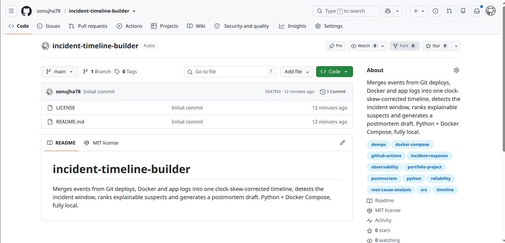

| # | Step | What | Why | Result |
|---|---|---|---|---|
| 1 | Scaffold | Repo, `pyproject.toml`, venv, smoke test | Start from a clean, repeatable base. Only `pyyaml` and `pytest` as dependencies, so Python 3.14 has no wheel problems. | 1 test |
| 2 | Event schema + redaction | `Event`, UTC parsing, secret redaction | Everything else works on one format. Redaction is applied when an event is built, so a secret never gets stored. Also fixed the `project.license` deprecation warning. | 19 tests |
| 3 | Collectors | git, docker, app log, health | Each source reads a file. That is what makes replay possible. | 25 tests |
| 4 | Clock + timeline | Anchor-based offsets, deterministic merge | Fix the order without hiding real delays. Merge order is a total order, so input order does not matter. | 38 tests |
| 5 | Incident window | Consecutive bad/good probes, flap merge | Blips must not count. Accuracy equals one probe interval and is tested. | 52 tests |
| 6 | Ranking + metrics | Explainable score, confidence, TTD/TTR | A person must see why a change was ranked first. | 71 tests |
| 6b | Causality check | Container start before its deploy forces LOW | See problem 2 below. | |
| 7 | Postmortem | Markdown generator, `analyze()` pipeline | The deliverable. Deterministic, redacted a second time at the end. | 88 tests |
| 8a | Demo environment | Compose app + DB, recorder, replay loader, first recording | Real incidents with a known cause, with clocks skewed on purpose. | 101 tests |
| 8b | More incidents | failing dependency, resource exhaustion, no clear cause | Three incident types plus a case with no answer. | 103 tests |
| 8c | Fixes from real data | Anchor voting, rollout-aware stability | Problems 5-7 below. | 112 tests |
| 9 | CLI + ground-truth check | `itb analyze`, `itb check`, repro tests | Turn "it looks right" into pass/fail. | 127 tests |
| 10 | CI | pytest, `itb check`, report `cmp`, secret scan | The tool is checked against the known causes on every push. | green on 3.12 and 3.14 |

The three incident types were recorded from real containers (`docker events`, app log file, a 1 s health probe):

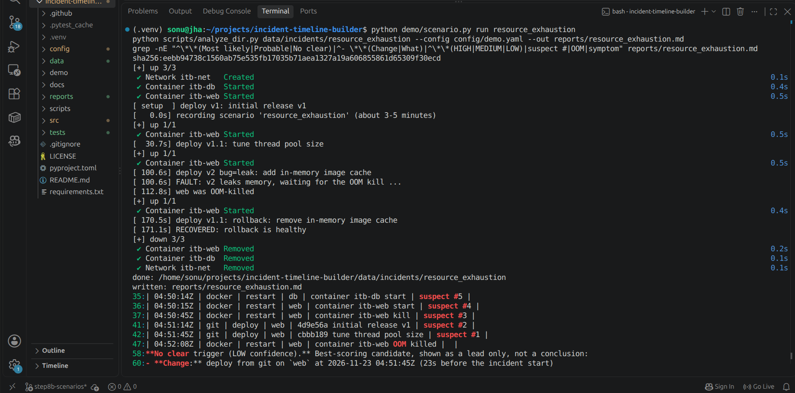

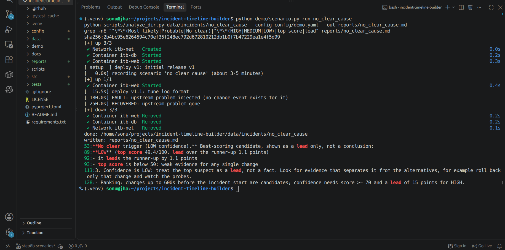

### Branch protection

Direct pushes to `main` are blocked (pull request required, force pushes blocked).

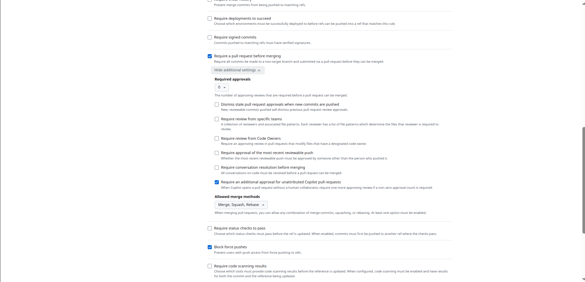

---

## Problems found and how they were fixed

The checker and the recorded incidents found real bugs that my synthetic tests had missed.

| # | Problem | Root cause | Fix |
|---|---|---|---|
| 1 | Python 3.14: `project.license as a TOML table is deprecated` | Old `pyproject.toml` syntax | `license = "MIT"` (SPDX string) |
| 2 | With clock correction turned off, the tool named a container restart as the cause with **HIGH** confidence | A skewed clock put the real deploy after the incident start | Causality check: a container start before its deploy forces LOW and says why |
| 3 | Old container `kill/stop/die` during a deploy became suspects; the old container's clean exit counted as a failure | Rollout events looked like independent changes | Treat them as part of the rollout; only OOM, kill or a non-zero exit is abnormal; `start_grace_s` for leftover clock error |
| 4 | `docker kill` produced `kill` and `die` milliseconds apart, counted as two suspects | One failure, two events | Collapse them within `burst_window_s` (5 s) |
| 5 | **Clock correction did not apply** on real recordings; the real cause ranked #4 | Matching each deploy to the nearest restart fails when the skew (60 s) is larger than the gap between deploys (30 s) | **Cluster voting**: choose the offset that explains the most deploys; restrict anchors to container `start` |
| 6 | Harmless old deploys scored 77-84 and hid the real cause | 1-2 failed probes during a rollout cancelled the stability penalty | `settle_s`: probe failures within 10 s of a rollout are ignored |
| 7 | The real cause had no supporting error logs | Logs about the database arrived a few seconds after detection | `symptom_window_s`: logs up to 15 s after detection still count (12 matching logs found afterwards) |
| 8 | A single old harmless deploy would reach MEDIUM because there was no runner-up | Lead looked large when there was nobody to compare with | Test written first (it failed), then a cap: a long-stable top suspect is capped at LOW |
| 9 | In `resource_exhaustion` the app log gave **0 events** | An OOM-killed process cannot write an error line; only INFO lines existed | Keep INFO lines as `info` events (found by the ground-truth check) |

Problem 5 as it showed up: the real cause (`itb-db kill`) was ranked #4 behind a harmless deploy, and the tool
was LOW instead of HIGH because the git clock was not corrected.

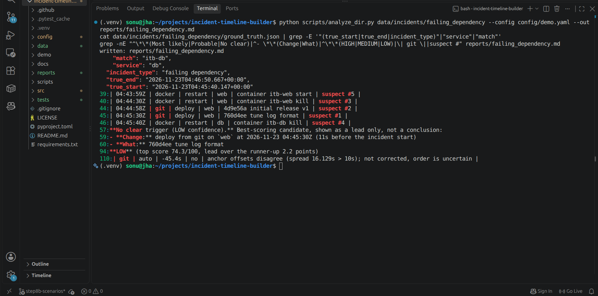

After the anchor fix the clock was corrected, but two more issues were still open (problems 6 and 7).

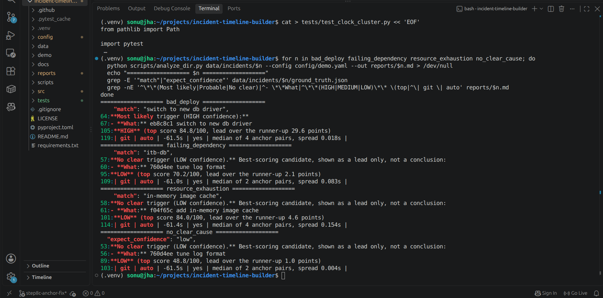

Because analysis is replay-based, all of this was fixed **without recording again**.

A useful detail: even while the ranking was wrong, the tool never answered wrongly with HIGH confidence. The
order check and the clock caveat kept it at LOW.

---

## CI

On every push and pull request, on Python 3.12 and 3.14: `pytest`, then `itb check -v` (fails if any result
differs from the known cause), the result table in the job summary, a fresh `itb analyze` of every incident
compared with the committed report using `cmp`, the secret scan, and the reports as an artifact.
Docker is not needed in CI, because the recorded data is in the repository.

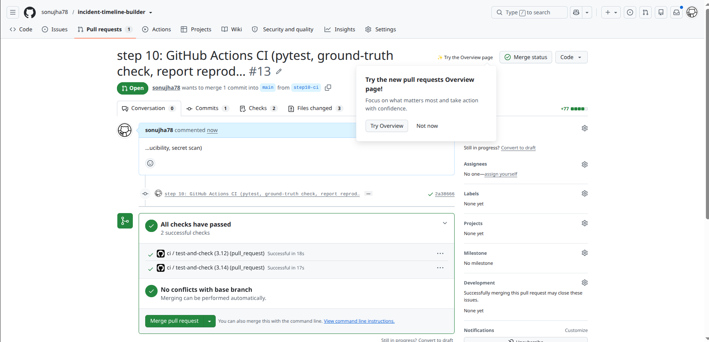

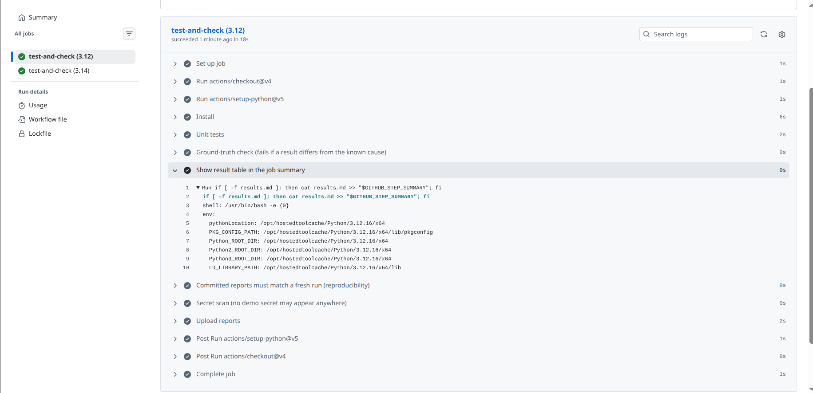

**Proof that CI really fails:** I changed the true start time of one incident to the year 2020 on a throw-away
branch (PR #14, closed without merging). Both jobs went red.

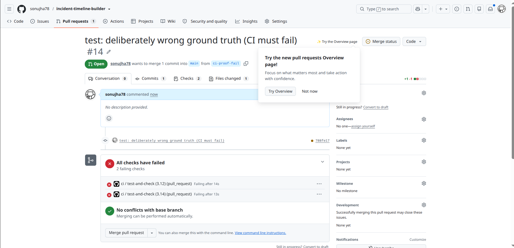

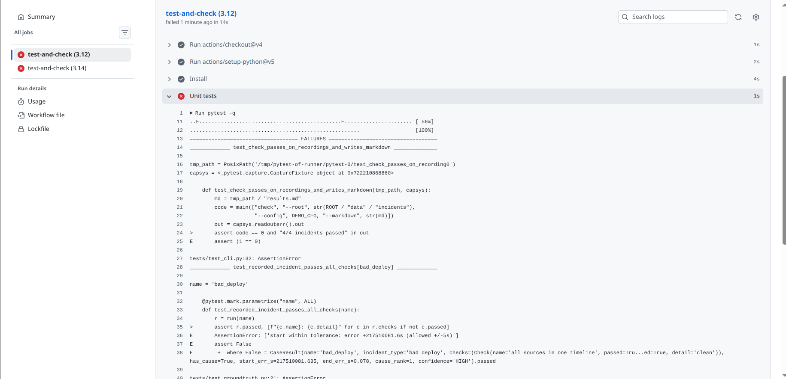

The failure shows up twice, in `pytest` (it contains ground-truth tests) and in `itb check`.

---

## Known limitations (honest notes)

- **Only 4 recorded incidents, and the thresholds were tuned after I saw them** (steps 8b, 8c and 9). So 4 of 4
  is not an independent test. A fair next step is to record new incidents with other timings and test without
  changing any weights.
- The git history in the demo is **synthetic**: the scenario runner writes the deploy record itself (with a
  deliberate +60 s skew). The Git collector reads a JSON-lines format, not a live `git log` yet.
- Scores are hand-set heuristics, not probabilities, and are not calibrated.
- Corroboration gives full points to every change that happened before the error logs started. The stability
  penalty balances this, but a cleaner rule would credit only the last change before the symptoms.
- One main incident per analysis, one affected service. Probes are the only service-level signal.
- Start and end are accurate to one probe interval (1 s in the demo), and the demo faults are much simpler than
  real production failures.
- A cause that is not a change event (a traffic spike, a cloud outage, an expired certificate) cannot be named.
  The tool then reports LOW confidence and lists what it does not collect.
- Stretch goals (chat summary, similar past incidents, code diff of the suspect, Grafana annotation, quality
  score) are **not implemented**.

---

## Answers to the design questions

1. **Language?** Python: quick to write, strong standard library for JSON, time and subprocess, easy to test. Standard library plus PyYAML, so it also runs on a very new Python.
2. **Collect without agents?** Read what already exists: `docker events`, the app log file, an HTTP probe, and the git/deploy log. The recorder only writes files; nothing is installed in the services.
3. **Event format?** `ts, source, type, service, description` plus `raw_ts`, `skew_applied_s`, `attrs`, `event_id`. A new source is one function returning `Event` objects.
4. **Clock disagreement without hiding delays?** One constant offset per source from anchor pairs, applied only when the pairs agree; raw time kept; the tool refuses to correct when unsure.
5. **Start and end without blips?** N bad probes in a row to open, N good in a row to close, flap merge, minimum duration, and the accuracy stated as one probe interval.
6. **Simple, explainable, hard to fool ranking?** An additive score where each component has a plain-text reason, plus guards against symptoms, rollouts, repeated events and long-stable changes.
7. **Test against known causes?** Record incidents with an injected, known cause; `itb check` compares start, end and cause rank; CI fails on any mismatch. A pass means: start and end within tolerance, cause in the top 3, LOW for the no-cause case.
8. **Show uncertainty without being useless?** Always show the best candidate and the full breakdown, but label it as a lead (not a conclusion) when confidence is not HIGH, and say why.

---

## Interview talking points

- **Why replay-based?** Analysis only reads files, so live and replay share one code path. That gives reproducible postmortems, tests with ground truth and free CI. I fixed three ranking bugs without recording again.
- **Clock skew.** Constant offset per source from anchor pairs, cluster voting to pick the offset, refuse when pairs disagree, keep `raw_ts`. A real bug: nearest-match anchoring failed when the skew was larger than the spacing between deploys. Synthetic tests missed it; real recordings found it.
- **Hard to fool.** Symptom is not a cause, rollout is not a cause, one failure counts once, stability penalty, margin-based confidence, and a causality check that forces LOW when event order looks impossible.
- **Honesty.** One test run showed a wrong answer with HIGH confidence when clock correction was off. That led to the order check. The tool must be able to say "I do not know"; there is a recorded incident for exactly that.
- **Evaluation.** Ground-truth files per incident, explicit tolerance, a table of start/end error and cause rank, and CI that fails on mismatch. I also proved CI fails by pushing a wrong ground truth. I also know the limits: 4 incidents, tuned on them.
- **Secrets.** Redaction at record time, at event creation and on the final report, tested with canary secrets planted on purpose, plus a CI scan.
- **Trade-offs.** Hand-set explainable weights instead of ML (nothing to train on, and every number must be explainable); standard library only; Docker only for recording.
- **What next?** Real `git log` and Kubernetes events as collectors, more incident types and held-out incidents, Slack/Grafana stretch goals, and calibrating scores on more data.

---

## Repository layout

```text
src/itb/            events, redact, collectors/, clock, timeline, detect, rank, metrics,
                    postmortem, pipeline, replay, record, groundtruth, cli
config/             itb.yaml (all thresholds, documented), demo.yaml (demo overrides)
demo/               Dockerfile, compose.yaml, app/ (web + db stubs), scenario.py (runner + recorder)
data/incidents/     4 recorded incidents + meta.json + ground_truth.json each
reports/            postmortem draft per recorded incident
docs/               results.md, examples/, images/
scripts/            small demos (skew, detection, ranking, report) and analyze_dir.py
tests/              127 tests
.github/workflows/  ci.yml
```

## License

MIT
